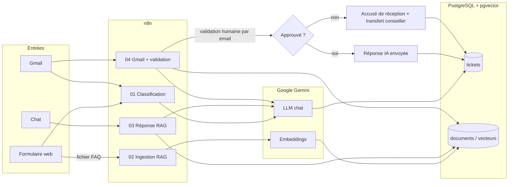

# Enterprise AI Copilot — Support client automatisé avec n8n

Un copilote IA pour le support client, construit avec **n8n**, **Google Gemini** et **PostgreSQL + pgvector**.
Il classe automatiquement les demandes, répond aux questions grâce à une base de connaissances (RAG)
et rédige des réponses aux emails qui sont **validées par un humain** avant envoi.

## 🎯 Objectif

- Réduire le temps de traitement des demandes clients.
- Centraliser chaque demande dans une base `tickets` (catégorie, priorité, résumé, statut).
- Répondre de façon fiable en s'appuyant uniquement sur la documentation interne (RAG).
- Garder un humain dans la boucle : aucune réponse IA n'est envoyée sans validation.

## 🏗️ Architecture



Tout tourne en local avec **Docker Compose** : un conteneur `postgres` (image pgvector) et un conteneur `n8n`.

## 🔁 Les 4 workflows

| # | Workflow | Déclencheur | Ce qu'il fait |
|---|----------|-------------|---------------|
| 01 | **Classification des demandes** | Formulaire web ou nouvel email Gmail | Gemini classe la demande (authentification, facturation, technique, commercial, autre), attribue une priorité (basse / moyenne / haute) et un résumé, puis enregistre le ticket dans Postgres. |
| 02 | **Ingestion RAG** | Formulaire d'upload de fichier | Découpe le document, calcule les embeddings avec Gemini et les stocke dans la table vectorielle `documents` (pgvector). |
| 03 | **Réponse RAG** | Chat n8n | Un agent IA cherche la réponse dans la base de connaissances et répond en français, de façon courte et polie. S'il ne trouve pas, il indique que la demande est transmise à un conseiller. |
| 04 | **Gmail avec validation** | Nouvel email Gmail | Classe l'email, rédige une réponse via le RAG, puis envoie la proposition à un validateur (*send and wait*). Si elle est approuvée, la réponse part au client (statut `repondu`). Sinon, le client reçoit un accusé de réception et le ticket passe en `a_traiter_conseiller`. |

Un exemple de base de connaissances est fourni dans [`faq-support.txt.txt`](faq-support.txt.txt)
(remboursements, mot de passe oublié, compte bloqué, horaires, résiliation).

## 🧰 Stack

- [n8n](https://n8n.io) : orchestration des workflows
- Google Gemini : LLM et embeddings
- PostgreSQL 16 + [pgvector](https://github.com/pgvector/pgvector) : tickets et recherche vectorielle
- Docker Compose

## 🚀 Lancer le projet

### Prérequis

- Docker Desktop
- Une clé API Google Gemini ([Google AI Studio](https://aistudio.google.com/))
- Un compte Gmail avec accès OAuth (pour les workflows 01 et 04)

### 1. Cloner et configurer

```bash
git clone https://github.com/salma-bourzg/enterprise-ai-copilot.git
cd enterprise-ai-copilot
cp .env.example .env   # puis modifier le mot de passe Postgres
```

### 2. Démarrer les conteneurs

```bash
docker compose up -d
```

- n8n : http://localhost:5678
- Postgres : `localhost:5432` (la table `tickets` est créée automatiquement par `sql/init.sql` au premier démarrage)

### 3. Importer les workflows

Dans n8n : **Workflows → Import from file**, puis importer les 4 fichiers `01 - … .json` à `04 - … .json` à la racine du dépôt.

### 4. Configurer les credentials dans n8n

| Credential | Valeurs |
|------------|---------|
| **Postgres** | Host `postgres`, port `5432`, base / utilisateur / mot de passe = ceux du `.env` |
| **Google Gemini (PaLM) API** | Votre clé API Gemini |
| **Gmail OAuth2** | Votre client OAuth Google |

Dans le workflow 04, remplacez `validateur@example.com` (nœud *Send message and wait for response*)
par l'adresse de la personne qui valide les réponses.

### 5. Alimenter la base de connaissances

Activez le workflow **02**, ouvrez son formulaire et envoyez `faq-support.txt.txt`.
Vous pouvez ensuite tester le workflow **03** dans le chat n8n.

## 🔒 Sécurité

- Aucun secret n'est versionné : les clés API et tokens OAuth restent dans les credentials n8n (volume Docker local).
- Le mot de passe Postgres est dans `.env`, exclu par `.gitignore`. Seul `.env.example` est publié.

## 👤 Auteur

**Salma Bourzg** — [github.com/salma-bourzg](https://github.com/salma-bourzg)
